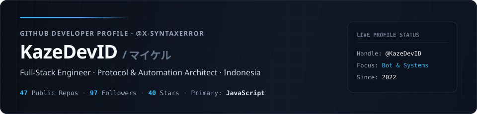
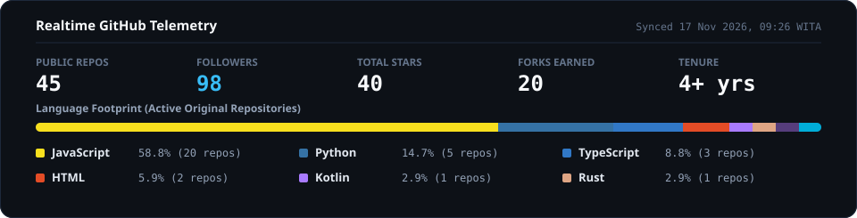

<div align="center">

<a href="https://github.com/KazeDevID">
  
</a>

<br />

<a href="https://git.io/typing-svg">
  
</a>

<p>
  <a href="https://github.com/KazeDevID?tab=followers">
    
  </a>
  <a href="https://github.com/KazeDevID?tab=repositories">
    
  </a>
  <a href="https://komarev.com/ghpvc/?username=KazeDevID">
    
  </a>
  <a href="https://lynk.id/kenalkaze">
    
  </a>
</p>

</div>

---

### About

```ts
const kazeDevID = {
  name: "Kaze (マイケル)",
  organization: "@X-SyntaxError",
  location: "Indonesia",
  focus: ["Messaging Protocol Libraries", "Full-Stack Web Apps", "Rust & Kotlin Systems"],
  flagships: ["@kazedevid/kazewa", "baileys-rec", "weabot-rust", "telegix", "jadestream"],
  links: "https://lynk.id/kenalkaze",
};
```

---

### Realtime Telemetry

<div align="center">
  
</div>

<br />

<div align="center">
  
</div>

<br />

<div align="center">
  
</div>

---

### Flagship Projects

| Project | Stack | Overview |
| :--- | :--- | :--- |
| [**kazewa**](https://github.com/KazeDevID/kazewa) | `TypeScript` | Next-gen WhatsApp Web Bot API & protocol library with compact session storage and dual pairing ([npm](https://www.npmjs.com/package/@kazedevid/kazewa)) |
| [**baileys-rec**](https://github.com/KazeDevID/baileys-rec) | `JavaScript` | Enhanced Baileys with Native Flow interactive buttons, Cloud API protocol adapter, and rich message builders |
| [**weabot-rust**](https://github.com/KazeDevID/weabot-rust) | `Rust` | High-throughput multi-device WhatsApp engine written in Rust |
| [**userbot-tg**](https://github.com/KazeDevID/userbot-tg) | `JavaScript` | MTProto-powered Telegram userbot and automated personal assistant engine |
| [**telegix**](https://github.com/KazeDevID/telegix) & [**teh**](https://github.com/KazeDevID/teh) | `TypeScript` | Lightweight Telegram Bot API frameworks for Node.js, Bun, and Deno |
| [**free-subdo**](https://github.com/KazeDevID/free-subdo) | `Cloudflare` | Automated `*.zettai.my.id` free subdomain registry powered by Cloudflare DNS |

---

### Recently Updated Repositories

<!-- REALTIME:REPOS:START -->
| Repository | Description | Language | Stars | Updated |
| :--- | :--- | :--- | :---: | :---: |
| [**weabot-ruby**](https://github.com/KazeDevID/weabot-ruby) | Modular WhatsApp Bot in Ruby powered by KazeDevID/baileys-rec-rb with plugin ho... | `Ruby` | 0 | 1d ago |
| [**whatsapp-web-ruby**](https://github.com/KazeDevID/whatsapp-web-ruby) | WhatsApp Bot & Automation Library for Ruby (Multi-Device, Interactive Buttons, ... | `Ruby` | 1 | 4d ago |
| [**fruitdrop-auto**](https://github.com/KazeDevID/fruitdrop-auto) | Yeetalk Fruit Merge Auto Drop Bot with real-time detection & floating overlay | `Kotlin` | 0 | 5d ago |
| [**baileys-rec**](https://github.com/KazeDevID/baileys-rec) | Enhanced Baileys with Native Flow Interactive Buttons, WhatsApp Cloud API Proto... | `JavaScript` | 0 | 9d ago |
| [**baileys-rec-bot**](https://github.com/KazeDevID/baileys-rec-bot) | Modern WhatsApp bot built with baileys-rec, modular plugin handler (wabot-aq st... | `JavaScript` | 0 | 11d ago |
| [**kazewa**](https://github.com/KazeDevID/kazewa) | Next-Gen WhatsApp Web Bot API & Protocol Library with ultra-compact session sto... | `TypeScript` | 0 | 12d ago |
<!-- REALTIME:REPOS:END -->

---

### Recent Activity

<!-- REALTIME:ACTIVITY:START -->
- Pushed 1 commit to [**KazeDevID/weabot-ruby**](https://github.com/KazeDevID/weabot-ruby) · *1d ago*
- Pushed 1 commit to [**KazeDevID/whatsapp-web-ruby**](https://github.com/KazeDevID/whatsapp-web-ruby) · *5d ago*
- Pushed 1 commit to [**KazeDevID/fruitdrop-auto**](https://github.com/KazeDevID/fruitdrop-auto) · *5d ago*
- Starred [**KazeDevID/whatsapp-web-ruby**](https://github.com/KazeDevID/whatsapp-web-ruby) · *4d ago*
- Open-sourced [**KazeDevID/fruitdrop-auto**](https://github.com/KazeDevID/fruitdrop-auto) · *7d ago*
<!-- REALTIME:ACTIVITY:END -->

---

### Tech Stack

<div align="center">
  <a href="https://skillicons.dev">
    
  </a>
</div>

---

### Connect & Support

<div align="center">
  <a href="https://lynk.id/kenalkaze">
    
  </a>
  <a href="https://www.npmjs.com/package/@kazedevid/kazewa">
    
  </a>
  <a href="https://ko-fi.com/kazedev">
    
  </a>
  <a href="https://www.buymeacoffee.com/kazedev">
    
  </a>
</div>

<br />

<div align="center">
  <sub>
    <!-- REALTIME:SYNC:START -->
Last realtime sync: **23 Nov 2026, 13:22 WITA** · Automated via GitHub Actions
<!-- REALTIME:SYNC:END -->
  </sub>
</div>
